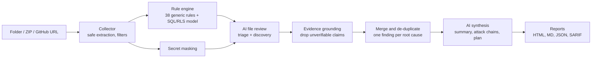

# CodeWarden AI

**AI-assisted source-code security review: Find. Fix. Fortify.**

CodeWarden AI analyses an application's source code, identifies security vulnerabilities with line-level evidence,
recommends secure code fixes, and generates a complete security assessment report (HTML, Markdown, JSON and SARIF).

It combines a generic, language-aware rule engine with a large language model that verifies every candidate,
rejects false positives, recalibrates severity, discovers logic flaws (broken authorisation, IDOR, privilege
escalation) and writes developer-friendly explanations and fixes. Every AI claim must quote a real line of code
or it is discarded.

Built for the **CDF CyberSec Hackathon 2026 - Intelligent Code Security Challenge**.

| | |
|---|---|
| Sample report (CDF TaskFlow) | [`reports/sample-report.html`](reports/sample-report.html) / [`.md`](reports/sample-report.md) &nbsp;(live: **https://REPLACE-WITH-NETLIFY-SITE.netlify.app/report.html**) |
| Rules-only baseline | [`reports/baseline-rules-only/`](reports/baseline-rules-only/) |
| Demo video | **https://youtu.be/REPLACE_WITH_VIDEO_ID** |
| Architecture and AI design | [`docs/ARCHITECTURE.md`](docs/ARCHITECTURE.md) |
| Rule catalog | [`docs/RULES.md`](docs/RULES.md) |
| Evaluation | [`eval/`](eval/) |

---

## Contents

1. [Quick start (Windows)](#1-quick-start-windows)
2. [Quick start (macOS / Linux)](#2-quick-start-macos--linux)
3. [Choosing an AI provider](#3-choosing-an-ai-provider)
4. [Using the web interface](#4-using-the-web-interface)
5. [Using the command line](#5-using-the-command-line)
6. [How it works](#6-how-it-works)
7. [How AI is used](#7-how-ai-is-used)
8. [What it detects](#8-what-it-detects)
9. [The report](#9-the-report)
10. [Accuracy and evaluation](#10-accuracy-and-evaluation)
11. [Security of the tool itself](#11-security-of-the-tool-itself)
12. [Project structure](#12-project-structure)
13. [Testing](#13-testing)
14. [Limitations](#14-limitations)
15. [Attribution and reused components](#15-attribution-and-reused-components)

---

## 1. Quick start (Windows)

Requirements: **Python 3.9+** (3.12 recommended) and Git. **No `pip install` is needed** - the tool uses only the
Python standard library.

```bat
git clone https://github.com/Santosh-2195/codewarden-ai.git
cd codewarden-ai
python --version
copy .env.example .env
notepad .env
```

In Notepad, paste one API key (for example `GEMINI_API_KEY=...`), save and close. Then:

```bat
python -m codewarden doctor
python -m codewarden serve
```

`doctor` should print `OK: gemini:gemini-flash-latest` (or your provider). `serve` opens
http://127.0.0.1:8765/ in your browser.

To scan the included sample from the command line instead:

```bat
python -m codewarden scan vulnerable-app --project "CDF TaskFlow"
```

Reports are written to `reports\`. Open the HTML report with `start reports\cdf-taskflow-security-report.html`.

> No API key? Run `python -m codewarden scan vulnerable-app --provider none` for a rules-only scan.

## 2. Quick start (macOS / Linux)

```bash
git clone https://github.com/Santosh-2195/codewarden-ai.git
cd codewarden-ai
cp .env.example .env          # add one API key
python3 -m codewarden doctor
python3 -m codewarden serve   # or: python3 -m codewarden scan vulnerable-app --project "CDF TaskFlow"
```

## 3. Choosing an AI provider

CodeWarden talks to providers over HTTPS with Python's `urllib`; no SDKs are installed. Put **one** key in `.env`.
The provider is auto-detected (order: Anthropic, OpenAI, Gemini, Groq, OpenRouter) or chosen with `--provider`.

| Provider | `.env` variable | Default model | Notes |
|---|---|---|---|
| Google Gemini | `GEMINI_API_KEY` | `gemini-flash-latest` | Free tier key from Google AI Studio. Use `--workers 1` if you hit rate limits. |
| Anthropic Claude | `ANTHROPIC_API_KEY` | `claude-sonnet-5-5` | Paid API; strong code reasoning. |
| OpenAI | `OPENAI_API_KEY` | `gpt-4.1-mini` | `OPENAI_BASE_URL` supports Azure-style or proxy endpoints. |
| Groq | `GROQ_API_KEY` | `llama-3.3-70b-versatile` | Free tier; fast open models. |
| OpenRouter | `OPENROUTER_API_KEY` | `openrouter/auto` | One key, many models. |
| Ollama (local) | none | `qwen2.5-coder:7b` | Fully offline: `ollama pull qwen2.5-coder:7b`, then `--provider ollama`. Code never leaves the machine. |
| Any OpenAI-compatible server | `OPENAI_COMPATIBLE_BASE_URL` | set `CODEWARDEN_MODEL` | LM Studio, vLLM, etc. |

Override the model with `--model <name>` or `CODEWARDEN_MODEL`. Model names change over time; if a provider returns
"model not found", set a model your account can use.

AI responses are cached in `.codewarden/cache/` (keyed by prompt, model and code), so re-running a scan is fast,
free and reproducible. Use `--no-cache` to force fresh analysis.

## 4. Using the web interface

```bat
python -m codewarden serve
```

1. Choose the source: **ZIP upload** (drag and drop), **Local folder** (paste a path such as
   `C:\Users\you\projects\my-app`), or **GitHub URL** (public repositories).
2. Pick the AI provider. "(key found)" means the key was read from `.env`; you can also paste a key, which is kept
   in memory for that scan only.
3. Enter the application name and select **Run security review**.
4. Watch the progress log, expand any finding to see the evidence, impact, fix and secure code, then
   **Open full report** or download HTML / Markdown / JSON / SARIF.

## 5. Using the command line

```text
python -m codewarden scan <folder | file.zip | https://github.com/owner/repo> [options]

  --provider auto|none|anthropic|openai|gemini|groq|openrouter|ollama|openai-compatible
  --model NAME            model override
  --project "My App"      application name shown in the report
  --out DIR               output directory (default: reports)
  --name BASENAME         report file name (default: <project>-security-report)
  --format md,html,json,sarif
  --max-files 60          files sent to the AI, highest risk first
  --workers 3             parallel AI requests (use 1 on free tiers)
  --min-severity Low      hide findings below a severity
  --fail-on High          exit code 1 if such a finding exists (CI gate)
  --no-cache              ignore cached AI responses

python -m codewarden serve [--port 8765] [--no-browser]
python -m codewarden rules [--markdown]
python -m codewarden doctor [--provider gemini]
```

Examples:

```bat
python -m codewarden scan vulnerable-app --project "CDF TaskFlow" --out reports --name sample-report
python -m codewarden scan C:\code\shop-api.zip --provider anthropic --min-severity Medium
python -m codewarden scan https://github.com/owner/repo --provider gemini --workers 1
```

## 6. How it works



1. **Collect.** Loads source files (TS/JS/React, Python, SQL, config, HTML and more), skipping dependencies,
   build output, lock files and binaries. Repository content is treated as untrusted data and never executed.
2. **Detect candidates.** Generic rules flag secrets, injection, XSS, missing authentication, mass assignment,
   CORS, error leakage, weak crypto and debug settings. A small SQL model reads every migration together (tables,
   foreign keys, RLS state, policies, grants, functions) to catch database access-control flaws across files.
3. **Mask secrets.** Credential-like values are replaced with `[REDACTED_SECRET]` before code leaves the machine.
4. **AI review.** Each file is sent with project context (detected stack, file map, database schema and policies)
   and the rule candidates for that file. The model must give a verdict on every candidate (confirmed / needs
   validation / false positive), write a tailored explanation and drop-in fix, and report additional issues the
   rules could not see.
5. **Ground.** Each AI finding must quote an exact line from the file. The line is located in the real source
   (and the line number corrected if the model was off); findings whose evidence does not exist are dropped.
6. **Deduplicate.** Findings with the same root cause (same CWE family, same file and nearby lines) are merged;
   hygiene issues with one shared fix (e.g. error leakage in several handlers) become one finding with several
   locations.
7. **Synthesise.** The model writes the executive summary, attack chains and prioritised remediation plan using
   only the verified findings. Finding IDs it references are validated, and the overall risk rating can never be
   lower than the evidence supports.

Full design notes: [`docs/ARCHITECTURE.md`](docs/ARCHITECTURE.md).

## 7. How AI is used

The AI is part of the analysis, not a text decorator:

| AI contribution | Why it matters | Visible in the report as |
|---|---|---|
| Triage of every rule candidate | Removes false positives (e.g. sanitised HTML, constant values) | "Rejected by AI as false positives" metric |
| Severity recalibration with context | A wildcard CORS header is Low on a token-auth API, but part of a chain elsewhere | "AI severity calibration" on findings |
| Discovery of logic flaws | IDOR, missing ownership checks and business-logic gaps cannot be expressed as regex | Detection: "AI discovery (evidence-grounded)" |
| Context-aware fixes | Secure code written for the same framework, client library and table names | "Secure code" blocks |
| Uncertainty handling | Each finding is Confirmed or Needs validation with stated assumptions | "Validation notes" |
| Executive synthesis | Attack chains linking findings, prioritised plan by risk reduction per effort | Sections 5 and 6 |

Reliability controls: temperature 0, strict JSON schema, prompt-injection-resistant prompt (repository text is
data, never instructions), evidence grounding, validated finding IDs, response caching for reproducibility, and
graceful fallback to rule findings if a provider fails. Prompts are in
[`codewarden/ai/prompts.py`](codewarden/ai/prompts.py).

## 8. What it detects

All rules are generic; none encode answers for the sample app. Highlights:

- **Hard-coded secrets** - provider token formats, private keys, DB URLs, generic credential assignments, committed
  `.env` files. Placeholder values (e.g. `NOT_REAL`) are reported as an insecure pattern, not a leaked credential;
  client-side files are flagged as shipped to every browser.
- **Injection** - SQL built with template literals or concatenation (tagged templates like ``sql`...` `` are
  recognised as safe), Python f-string SQL, OS command injection, `eval`, SSTI, dynamic SQL in PL/pgSQL.
- **XSS** - `dangerouslySetInnerHTML` without sanitisation, `innerHTML`, `document.write`, `v-html`,
  Angular trust bypasses.
- **Broken access control** - server/edge handlers using service-role/admin credentials or direct DB connections
  without authenticating the caller; mass assignment of request bodies; open redirects; path traversal.
- **Database access control (PostgreSQL/Supabase RLS)** - `USING (true)` policies on owned data, policies
  inconsistent with their parent table, subqueries that never compare with `auth.uid()`, self-update policies that
  allow changing `role`/`is_admin` (privilege escalation), write policies that do not check the parent record,
  tables without RLS, grants to `anon`/`public`, `SECURITY DEFINER` without `search_path`.
- **Misconfiguration and data exposure** - wildcard CORS, internal errors returned to clients, debug mode,
  TLS verification disabled, weak hashing for passwords, `Math.random()` tokens, unverified JWTs, tokens in
  `localStorage`, `postMessage('*')`, unsafe YAML/pickle.

Full list: [`docs/RULES.md`](docs/RULES.md). Supported input languages for rules: TypeScript/JavaScript (React,
Node, Express, Deno), Python, SQL, HTML, config files. The AI review also covers Java, Go, PHP, Ruby, C# and
Kotlin files.

## 9. The report

Each report contains: assessment information, executive summary, findings by severity, a findings index, and for
every finding the ID, severity, status and confidence, category, CWE, OWASP Top 10 mapping, affected files and line
ranges, description, the vulnerable code with surrounding lines, potential impact, recommended fix, secure code
example, validation notes and references. It ends with attack chains, a prioritised remediation plan, an overall
assessment, methodology with AI pipeline metrics, and scope and limitations.

- **HTML** - self-contained, filterable (severity, confirmed-only, search), light/dark, prints cleanly to PDF
  (all findings expand automatically when printing).
- **Markdown** - for repositories and pull requests.
- **JSON** - machine-readable, all fields.
- **SARIF 2.1.0** - upload to GitHub code scanning or open in VS Code's SARIF viewer.

## 10. Accuracy and evaluation

`eval/benchmark/notehub` is a separate, intentionally vulnerable mini-app (Express, Flask, React, PostgreSQL) with a
labelled ground truth of 23 vulnerabilities plus 7 safe look-alike "decoys" that must not be flagged.

```bat
python eval\run_eval.py                    &REM rules-only baseline
python eval\run_eval.py --provider gemini  &REM full AI pipeline
```

Rules-only baseline (deterministic, no AI):

| Metric | Value |
|---|---:|
| Vulnerabilities found | 22 / 23 |
| Decoys wrongly flagged | 0 / 7 |
| Precision | 100% |
| Recall | 96% |

The one miss is the IDOR in `GET /api/notes/:id` (a parameterised query with no ownership check), which is a logic
flaw by design: it is the kind of issue the AI layer is responsible for. Results with AI enabled are written to
`eval/RESULTS-<model>.md`. Caveat: the benchmark was written by the same team as the rules, so treat it as a
regression and false-positive check rather than an independent accuracy claim.

## 11. Security of the tool itself

- Repository content is never executed; ZIPs are extracted with zip-slip, zip-bomb, absolute-path and symlink
  protection, with size and file-count limits.
- Prompt-injection resistance: code is wrapped as untrusted data, and the system prompt forbids following
  instructions found in it. Files containing instruction-like text are counted in the report.
- Secrets are masked before any code is sent to an AI provider and are masked again in every report.
- The local web UI binds to `127.0.0.1` only, rejects unexpected `Host` headers (DNS-rebinding defence), requires a
  random per-process token on every API call (CSRF defence), sets a strict CSP, and never logs API keys.
- All repository- and AI-generated text in the HTML report and web UI is escaped (tested), so a malicious
  repository cannot inject script into the report.
- `.env` is git-ignored; no keys are stored in the repository.

## 12. Project structure

```text
codewarden/
  cli.py            command line (scan, serve, rules, doctor)
  collector.py      folder / ZIP / GitHub input with safe extraction
  pipeline.py       orchestration, grounding, merging, de-duplication
  models.py         Finding, Location, metrics
  rules/            secrets, javascript, python_rules, sql_model, sql_rules
  ai/               providers (stdlib HTTP), prompts, reviewer (triage, discovery, synthesis, cache)
  report/           Markdown, JSON, SARIF (__init__.py) and HTML (html.py)
  server.py, web/   local web interface
tests/              unit and end-to-end tests (fake LLM, no network)
eval/               benchmark app, ground truth, evaluation script
reports/            sample report for CDF TaskFlow + rules-only baseline
site/               static showcase site (Netlify)
vulnerable-app/     CDF TaskFlow sample application (provided by the organisers)
docs/               architecture, rules, demo script, submission checklist
```

## 13. Testing

```bat
python -m unittest discover -s tests -v
```

29 tests cover the rules (positive and negative cases), SQL policy analysis, secret masking, ZIP safety, server
hardening, report escaping, and the full AI pipeline using a deterministic fake model (false-positive rejection,
hallucination dropping, line relocation, duplicate merging and summary sanitisation). CI runs the tests, a rules-only
scan and the benchmark on every push (`.github/workflows/ci.yml`).

## 14. Limitations

- Static analysis only: no exploit execution, dynamic testing, dependency/CVE audit or infrastructure review.
- AI output can still be wrong. Grounding guarantees the cited line exists, not that the reasoning is correct;
  findings marked "Needs validation" depend on runtime context.
- Files are reviewed one at a time with project-level context (file map, database model); deep inter-procedural
  data flow across many files is approximated rather than proven.
- Free-tier AI keys may rate-limit large repositories; use `--workers 1` and `--max-files`.

## 15. Attribution and reused components

- **Developed during the hackathon:** all code in `codewarden/`, `tests/`, `eval/`, `site/` and `docs/`.
  AI-assisted development tools (Claude) were used while writing the code and documentation, as permitted by the
  hackathon FAQ.
- **Third-party runtime libraries:** none. Only the Python standard library is used.
- **External services (optional, user-selected):** Anthropic, OpenAI, Google Gemini, Groq, OpenRouter APIs or a
  local Ollama server, used under their respective terms.
- **Provided by the organisers:** `vulnerable-app/` (CDF TaskFlow), included unchanged as the analysis target.
- **References:** CWE (MITRE), OWASP Top 10 2021 and Cheat Sheet Series, Supabase RLS documentation, SARIF 2.1.0.

License: MIT (see `LICENSE`). The sample application is excluded from this license.
